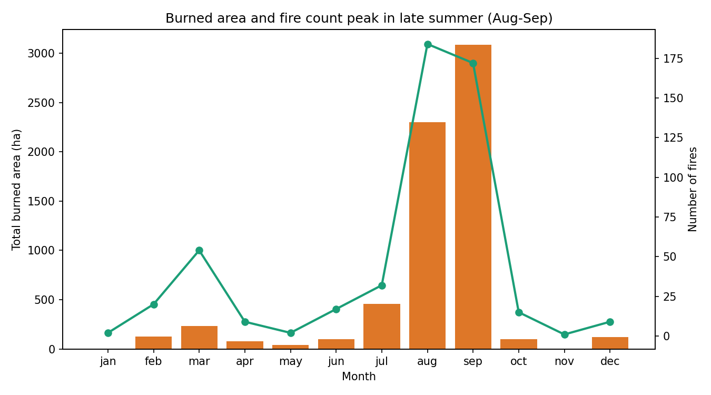
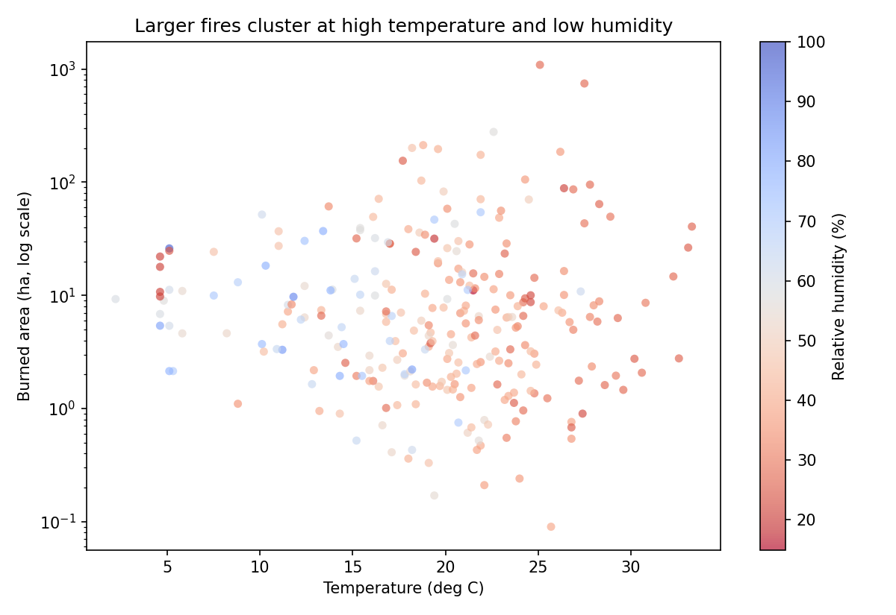

# Aung Minn Khant - Data Science Portfolio

## About Me

I am Aung Minn Khant (Student ID: MC651192), a postgraduate student at the
University of Macau studying data science, with a focus on data visualization,
exploratory data analysis, and machine learning. This portfolio showcases my
project work and is published with GitHub Pages.

## Technical Skills

- **Languages:** Python, SQL
- **Data analysis:** pandas, NumPy, scikit-learn
- **Visualization:** matplotlib, seaborn, Plotly
- **Tools:** Jupyter Notebook, Git/GitHub, GitHub Pages

## Project Showcase

### Forest Fire Burned-Area Analysis (Montesinho Natural Park)

**Research question:** When and under what weather conditions do the most
damaging forest fires occur in Montesinho Natural Park, Portugal, and how well
do Fire Weather Index (FWI) components relate to the burned area?

**Findings:** Analysis of 517 fires (2000-2003, UCI Forest Fires dataset) shows
that fire damage is heavily concentrated in late summer - August and September
alone account for more than 80% of the total burned area. The largest fires
cluster under hot, low-humidity conditions. However, the burned-area
distribution is extremely skewed (median 0.5 ha vs. max 1,090.8 ha), and
individual FWI indices correlate only weakly with log(area), so simple linear
models are not enough to predict fire size.

The scatter plot above shows that fires burning more than ~100 ha occur almost
exclusively above 20 deg C with relative humidity below 45%, which makes the
seasonal peak easy to explain.

- **Project repository:** [github.com/aungminnkhant94/data-science-project](https://github.com/aungminnkhant94/data-science-project)
- **Status:** Completed

---

*Published with GitHub Pages for CISC7204 Data Visualization, Practice 09.*
